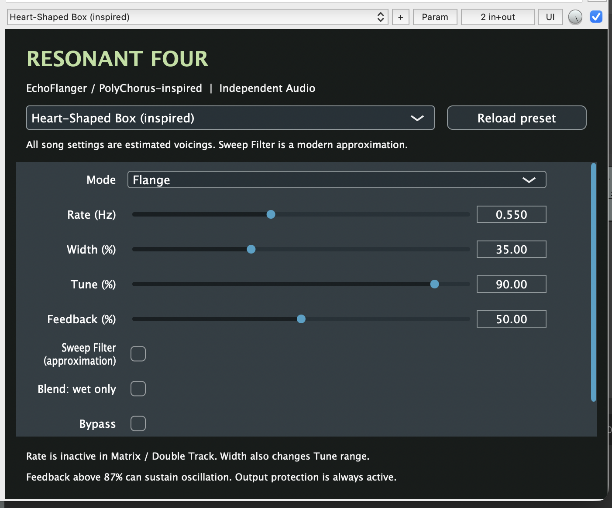

# Resonant Four

### Chasing the opening guitar sound of Nirvana’s “Radio Friendly Unit Shifter”

That metallic, resonant, moving guitar sound at the start of **“Radio Friendly Unit Shifter”** is instantly recognizable—and notoriously hard to find as a ready-to-use VST effect. **Resonant Four** is an independent JUCE VST3 built to explore that sound: an EchoFlanger-inspired effect with a dedicated, song-inspired RFUS starting preset, plus Flange, Chorus, Filter Matrix and Double Track modes.

Load the preset, place the plugin **before distortion or an amp sim**, then shape the Rate, Width, Tune and Feedback to suit your guitar and setup. It’s a practical starting point for the sound, with room to push it into your own feedback and modulation tones.

This is a fan-made, independent project. It is **not affiliated with or endorsed by Nirvana, Kurt Cobain or Electro-Harmonix**, and it is not a measured hardware clone. The RFUS preset is an informed listening-based approximation; exact pedal settings and a one-to-one match are not claimed. The code models selected behaviours of the 1978 EH-7700 EchoFlanger / PolyChorus family, with documented limits.





## Using the plugin

Load **Resonant Four** as an audio effect in your DAW. Start with output at -6 dB. Select a song preset from the editor's menu; “Reload preset” discards parameter edits and returns to the named starting point. The menu shows the last selected base preset even after editing. Every numerical song setting is estimated. The Radio Friendly Unit Shifter preset targets the song's intro; it was chosen by listening against the record over short-ring and flange alternatives. Put the plugin **before** your distortion or amp sim, as EHX advises for that song.

- Flange: short modulated delay, comb notches, resonant sweeps.
- Chorus: longer modulated delay, pitch movement, echo feedback.
- Filter Matrix: stationary short-delay comb; move Tune manually.
- Double Track: stationary longer echo. Rate is inactive here and in Matrix.
- Width: changes modulation depth **and** available Tune range, even in static modes. Pitch wobble is capped at Width x 1 semitone.
- Tune: clockwise shortens delay in Flange/Matrix and lengthens it in Chorus/Double Track. It is a relative control, not a millisecond readout.
- Feedback: above approximately 87% the nominal loop gain exceeds unity. Frequency-dependent filtering can raise the actual oscillation threshold. Saturation bounds the resulting oscillation. Lower Feedback or use Bypass to stop it.
- Sweep Filter: modern approximation, rounds modulation and darkens the wet/feedback path. Not a reconstructed switch from the 1978 schematic.
- Blend: wet only removes the direct component. Leave off for the familiar mixed comb/chorus effect.
- Bypass: fades to dry and damps the loop. Sample-peak protection remains active, including during bypass. Inputs up to 0.8 amplitude pass unchanged in steady bypass. Higher peaks are softened; this is deliberately not bit-transparent bypass.
- Output: trim before final protection. Protection uses a soft knee above 0.8 and caps sample amplitude at 0.98; it is not an intersample/true-peak limiter.

Mode changes briefly fade through dry and clear the old tail. Continuous controls are smoothed; delay changes intentionally produce pitch bends. Stereo channels have independent audio histories but share modulation phase. No compressor, amplifier or distortion pedal is included. Try external distortion after the plugin for the more extreme song-inspired sounds.

## Build

Requires CMake 3.22+, C++17, a supported JUCE toolchain and internet access for the initial JUCE 9.0.5 fetch. JUCE licensing applies separately; see its included licence before distributing commercial builds. The MIT licence here covers this project's code, not JUCE. Third-party reference materials are linked in the research notes and are not included.

```sh
cmake -S . -B build -DCMAKE_BUILD_TYPE=Release -DCMAKE_OSX_ARCHITECTURES='arm64;x86_64'
cmake --build build --target ResonantFour_VST3 engine_tests -j4
ctest --test-dir build --output-on-failure
```

On Linux omit `CMAKE_OSX_ARCHITECTURES` and install JUCE's platform dependencies; Linux builds have not been verified in this delivery. For an existing JUCE checkout add `-DJUCE_SOURCE_DIR=/absolute/path/to/JUCE` at configuration. Use a fresh build directory when changing that path.

The macOS product appears under `build/ResonantFour_artefacts/Release/VST3/Resonant Four.vst3`. After JUCE's manifest generation, sign with `codesign --force --deep --sign - 'path/to/Resonant Four.vst3'`. This is local ad-hoc signing, not Apple notarisation.

## Code map

- `Source/ResonantEngine.h`: allocation-free sample processing, delay, clock-inspired control law, feedback, filters, smoothing, output protection. Memory allocation is confined to prepare; mode changes clear preallocated buffers.
- `Source/PluginProcessor.cpp`: JUCE parameters, state, factory programs, buses and editor. Reuses the Small Clone project's processor/APVTS organisation; the engine is separate.
- `tests/EngineTests.cpp`: deterministic standalone DSP tests.
- `tests/HostCheck.cpp`: actual VST3 loading, state recall, variable-block render and editor snapshot via a small JUCE host.
- `research/RESEARCH.md`: evidence, preset provenance, architecture and approximations.
- `research/VALIDATION.md`: completed checks and remaining limits.

No measured hardware comparison, NE570 dynamic compander model, BBD clock leakage, component-level circuit solution or sample-rate oversampling is included. Saturation and fast modulation can introduce aliasing. Future calibration should use hardware delay/clock measurements, feedback threshold curves and matched audio recordings; changing parameter laws may change these presets.
